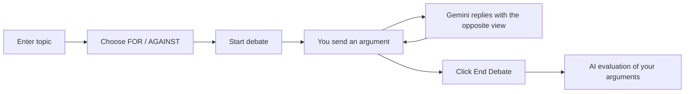
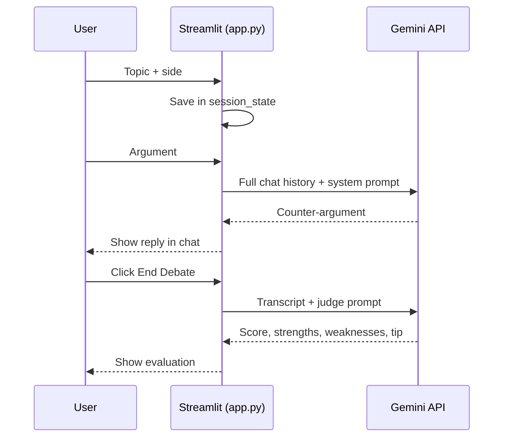

# 🗣️ AI Debate Partner

Debate any topic with Google Gemini. Pick **FOR** or **AGAINST**, and the AI takes the opposite side. When you finish, it judges your arguments.

Built with **Python**, **Streamlit** and the **Google Gemini API** (`google-genai`) as a college GenAI mini-project.

**🔗 Live demo:** _add your Streamlit link here after deployment_

---

## ✨ Features

- Enter any debate topic
- Choose your side (FOR / AGAINST)
- Chat with an AI that argues the opposite side in simple, friendly English
- Click **End Debate** to get a score, strengths, weaknesses and a tip
- No database. Chat history is kept in Streamlit session state.

---

## 🧭 User Flow



---

## 🏗️ How It Works



**Key ideas**

| Concept | How it is used |
|---|---|
| `st.session_state` | Remembers topic, side, chat history and evaluation between reruns |
| System prompt | Tells Gemini which side to defend, and to use short, simple English |
| Full history each turn | Gemini has no memory, so the whole chat is sent every time |
| Judge prompt | A second prompt that evaluates only the user's arguments |
| API key handling | Read from Streamlit Secrets (cloud) or `.env` (local), never hard-coded |

---

## 📁 Project Structure

```
ai-debate-partner/
├── app.py            # Whole app: UI, session state, Gemini calls
├── requirements.txt  # streamlit, google-genai, python-dotenv
├── .env.example      # Template for your API key
├── .gitignore        # Keeps .env and secrets out of Git
└── README.md
```

---

## 🚀 Run Locally

```bash
git clone https://github.com/Ankith34/AI-Debate-Partner.git
cd AI-Debate-Partner

python -m venv venv
source venv/bin/activate        # Windows: venv\Scripts\activate
pip install -r requirements.txt

cp .env.example .env            # Windows: copy .env.example .env
# open .env and paste your key

streamlit run app.py
```

Get a free API key at [aistudio.google.com/apikey](https://aistudio.google.com/apikey).

**`.env` file**
```
GEMINI_API_KEY=your_api_key_here
# Optional: GEMINI_MODEL=gemini-2.5-flash
```

---

## ☁️ Deploy Free on Streamlit Community Cloud

1. Push this repo to GitHub (make sure `.env` is **not** included).
2. Go to [share.streamlit.io](https://share.streamlit.io) and sign in with GitHub.
3. Click **Create app** and select your repo, branch `main`, file `app.py`.
4. Open **Advanced settings → Secrets** and add:
   ```toml
   GEMINI_API_KEY = "your_api_key_here"
   ```
5. Click **Deploy**.

---

## 🔧 Customize

- **AI personality:** edit `AI_PROMPT` in `app.py`
- **Evaluation style:** edit `eval_prompt` in `app.py`
- **Model:** set `GEMINI_MODEL` in `.env` or Secrets

---

## 🛠️ Troubleshooting

| Problem | Fix |
|---|---|
| `GEMINI_API_KEY not found` | Check `.env` (local) or Secrets (cloud) |
| Authentication / 400 error | Create a new key in Google AI Studio |
| Model not found | Set `GEMINI_MODEL` to a model your key supports |
| 429 / quota error | Free tier limit reached. Wait a minute and retry |

---

## 🔒 Security

Never commit your API key. `.env` is listed in `.gitignore`. If a key is ever exposed, delete it in Google AI Studio and create a new one.

---

## 📚 Tech Stack

Python · Streamlit · Google Gemini API · python-dotenv
